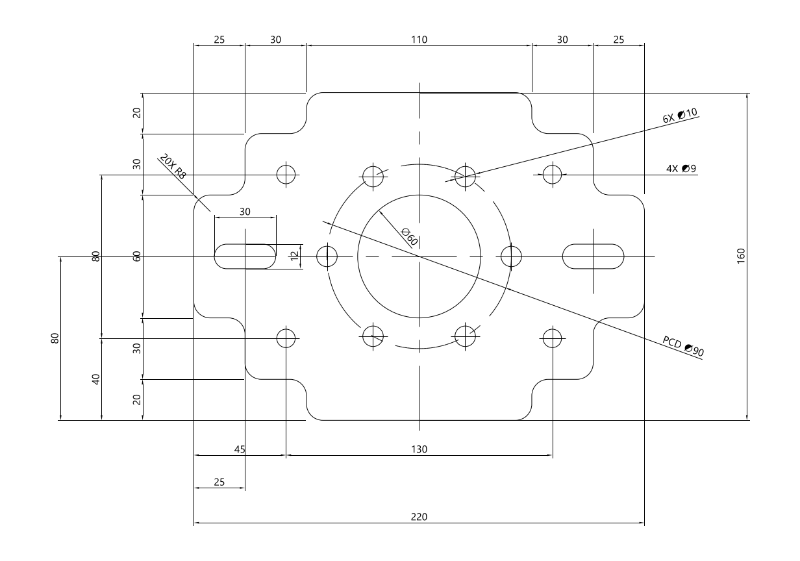

# Codex AutoCAD 绘图工具包

让 Codex 通过本机 MCP 调用 AutoCAD 2026，按尺寸分阶段绘制轮廓、孔槽、中心线和原生标注。1.1.0 新增结构化二维接口，并附两套 Skills、复杂阶梯法兰图纸和教学演示材料。

## 直接开始

1. 下载并完整解压 [1.1.0 Windows x64 安装包](releases/codex-autocad-mcp-2d-1.1.0-win-x64.zip)，运行 `plugin/scripts/install-package.ps1` 和 `install-skills.ps1`。
2. 启动 AutoCAD 2026，新建公制空白图纸，执行 AICADSTATUS。
3. 在 Codex 添加/刷新 `ai_cad` STDIO 服务，调用 health/context 确认连接。
4. 使用 [三阶段绘图提示词](examples/mcp-stepped-flange/prompts.txt) 完成轮廓、孔槽和尺寸，读取实际结果后保存新 DWG/DXF。

详细步骤见 [安装与连接](docs/getting-started.md)。安装包及 SHA-256 校验值位于 `releases/`；从源码构建需先运行 `build.ps1` 或 `install-user.ps1`。

## MCP 与 Skills

| 接口/技能 | 作用 |
|---|---|
| cad_draw_2d | 一个阶段创建直线、圆、圆弧、带 bulge 的多段线及四类原生尺寸 |
| cad_get_layers / cad_get_geometry | 读取实际图层和几何，每次最多20个句柄 |
| cad_save_drawing | 输出新的 DWG/DXF 副本，返回实际路径与文件大小 |
| $autocad-mcp-drawing | 检查连接、确定尺寸、拆分阶段、构建计划和处理重试 |
| $autocad-mcp-review | 检查真实孔槽、圆角和尺寸，整理教学演示证据 |

共17个工具，保留原有四孔底板三维/三视图、提议修改、撤销及分页读取。通用二维接口支持 [2d-1.0 字段契约](skills/autocad-mcp-drawing/references/plan-schema.md)，不开放任意代码执行。重复请求返回原句柄，保存不覆盖现有文件。

## 已有 AutoLISP 自动绘图路线

此路线由 Codex 根据完整尺寸创建 AutoLISP，在 AutoCAD 新图纸中自动分阶段绘制、缩放、导出预览、保存和重开校核，不安装 MCP 插件或 .NET SDK。下载仓库源码，在 Codex 打开文件夹后，明确选择 AutoLISP 路线并提交尺寸要求；无需手动 APPLOAD 或输入阶段命令。

既有说明见 [AutoLISP 自动绘图课程](docs/autolisp-auto-drawing.md) 或 [Word 课程稿](docs/autolisp-auto-drawing.docx)。已生成的 [DWG](practice/flange_auto.dwg)、[DXF](practice/flange_auto.dxf)、[阶段预览](practice/README.md) 和 [校核记录](practice/verification.json) 位于 `practice/`，原参考资料保留在 `examples/`。

## 文件

| 目录 | 用途 |
|---|---|
| plugin/ | AutoCAD .NET 插件、MCP Bridge、安装脚本与测试 |
| examples/mcp-stepped-flange/ | 新 MCP 的三阶段 JSON、提示词、实际 DWG/DXF、预览和验证证据 |
| skills/autocad-mcp-*/ | 配套绘图与复核技能，可安装到 Codex |
| examples/stepped-flange/ | 保留的独立 AutoLISP 演示路线 |
| skills/codex-autocad-toolkit/ | 仓库入口指引 |
| prompts/ | 首次开工提示词 |
| docs/ | 接入和验证说明 |
| practice/ | 已有 AutoLISP 自动绘图结果、练习和检查记录 |
| releases/ | 1.1.0 编译安装包与 SHA-256 校验值 |

## 环境与验证

运行编译包需要 Windows、AutoCAD 2026 和 .NET 8 x64 Runtime；源码构建需要 .NET 8 SDK。仓库不分发 Autodesk SDK 或软件安装程序。
113项单元测试通过，真实 MCP → 命名管道 → AutoCAD 核心引擎验证通过。默认法兰包含66个对象、25个原生尺寸，保存重开、孔槽与20处R8圆角已复核。见 [验证记录](docs/verification.md)。桌面录屏和其他软件版本不在此执行记录内。

原有代码来源：[CAD-SW-ANAYSIS 的 AiCad 部分](https://github.com/qu347/CAD-SW-ANAYSIS/tree/main/AiCad)。基础文件来源记录见 extraction-manifest.json；1.1.0 的二维接口与配套技能在此工具包中新增。
