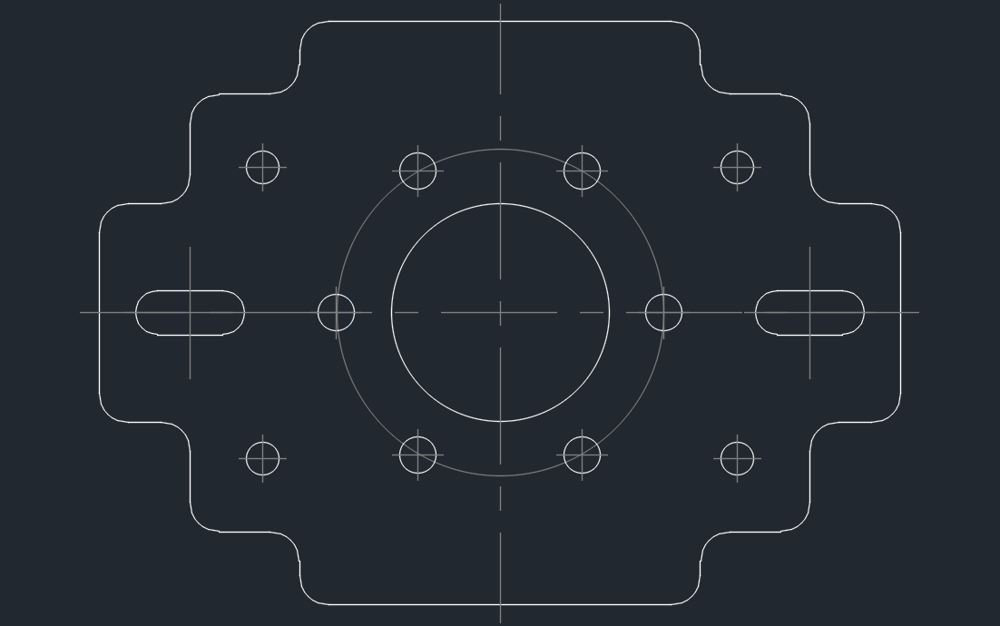
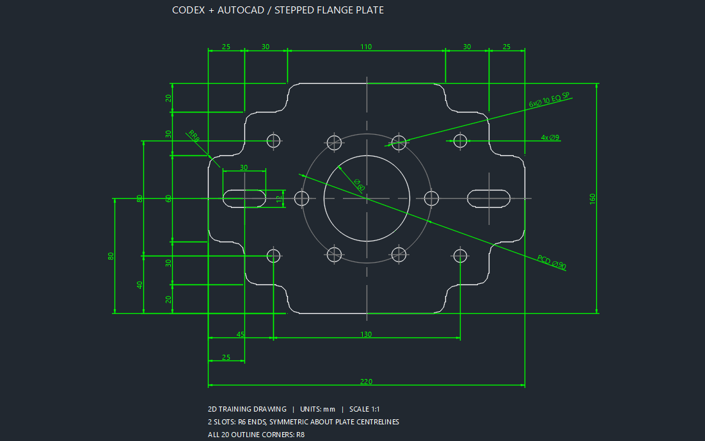
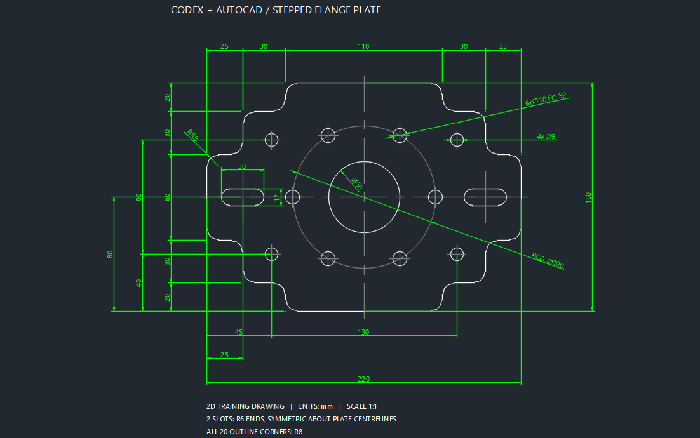

# Codex辅助CAD绘图实操学习包

零基础准备与阶梯法兰安装板实操

### 开课前先准备这些

开始画图之前，先准备电脑、账号、绘图软件和练习文件。即使你以前没有用过 AI，也可以先按下面的清单检查，准备完成后再开始本课。

1 电脑与网络：一台能够正常运行 AutoCAD 的 Windows 电脑，联网后能打开 Codex 并发送消息。

2 Codex：安装可使用 Codex 的 OpenAI 桌面客户端，用自己的 ChatGPT 账号登录，并切换到 Codex。本课需要它读取项目文件并把脚本保存到电脑。

3 AutoCAD：本课使用 Windows 桌面版 AutoCAD 2026，由 Codex 检查实际版本与安装路径，并通过软件原生接口创建新图纸、绘制、显示和保存。你不需要输入绘图命令。

4 练习文件：下载完整 CAD 工具包，解压到独立文件夹。在 Codex 中打开这个文件夹，后续生成的文件统一放到 practice 子文件夹。

### 先认识 AI Codex 和 AutoCAD

AI 是人工智能。在本课中，你用日常语言说明尺寸和绘图要求，AI 帮你整理步骤、编写脚本，并根据具体报错协助修改。它生成的结果仍需要在绘图软件中检查。

Codex 是我们使用的 AI 编程工具，负责读取练习资料、理解需求和生成绘图脚本。AutoCAD 是绘图软件，负责运行脚本、显示图形、测量尺寸和保存图纸。

AutoLISP 是 AutoCAD 使用的一种编程语言。本课生成的 .lsp 文件相当于一份可执行的绘图指令；由 Codex 自动交给 AutoCAD 执行，分阶段显示轮廓、孔槽和标注。全程不用 Computer Use、鼠标键盘模拟或手动 APPLOAD。

### 跟着练  留下哪些文件

完成一份绘图需求、一份可以运行的 LSP 脚本、原尺寸 DWG 图纸、改参数后的 DWG 图纸，以及记录实际测量值的检查结果。图纸打不开、测量值不一致或有报错，都需要先处理。

### 按这个顺序做

认识工具并完成准备 → 下载并打开项目 → 提交完整尺寸提示词 → Codex 检查并创建脚本 → 自动绘制轮廓并校核 → 自动绘制孔槽并校核 → 自动标注、保存和重开 → 改参数后自动生成新图。

## 打开软件并准备项目文件

### 先确认两个软件都能正常使用

打开 Codex，完成登录。在桌面客户端中选择 Codex；接下来打开下载后的项目文件夹，在这个项目中开始对话。官方安装和登录入口见文末的 OpenAI 入门说明。

确认 AutoCAD 已安装且能够正常使用。把后面的准备提示词交给 Codex，让它检查实际版本、安装路径与运行条件，并创建 practice/ready.txt。收到完整绘图提示词后，由 Codex 启动 AutoCAD 新空白图纸并直接绘制，不需要先手动画 LINE 或输入 SAVEAS。

### 下载完整工具包

仓库入口：[github.com/qu347/codex-autocad-toolkit](https://github.com/qu347/codex-autocad-toolkit)

在仓库点击 Code，再选 Download ZIP，完整解压到独立文件夹。在 Codex 中把这个文件夹设为项目工作目录，后面的练习文件统一放进 practice 子文件夹。

原版脚本和参考图保留在 examples/stepped-flange；本次自动执行的脚本、图纸、阶段预览与实际校核结果放在 practice。下表列出主要文件。

| 文件 | 用途 |
|---|---|
| 文件或目录 | 这节课怎么用 |
| README.md
docs/getting-started.md | 先确认接入路线和软件要求。 |
| drawing-prompt.txt | 完整绘图要求。文末也提供可复制版本。 |
| flange_demo.lsp | 已验证的参考脚本，用来对照命令和参数。 |
| flange_final.dwg 与 preview.png | 参考结果，用于查看图形和比对尺寸。 |
| verification.json | 默认图形的几何、标注和保存重开校核记录。 |
| practice/ | 本次自动生成的脚本、DWG、DXF、三个阶段预览和实际校核记录。 |
| skills/codex-autocad-toolkit/scripts/run-visible-lisp.py | 由 Codex 调用的原生自动执行器，用户无需输入命令。 |

### 把这段话交给 Codex

读取 README.md、docs/getting-started.md、skills/codex-autocad-toolkit/SKILL.md 和 examples/stepped-flange 里的文件。这节课只走 AutoLISP 路线。先检查 Windows 与实际 AutoCAD 版本，返回参考脚本的完整路径。创建 practice/ready.txt，写入已确认的版本和本课单位 mm，并返回实际文件路径。收到完整绘图提示词后，请直接自动绘制、显示、保存和校核，不让我输入命令，不使用 Computer Use，不安装 MCP 插件，不覆盖参考文件或原图。

确认 Codex 实际创建了 ready.txt，再提交文末的完整绘图提示词。此后由 Codex 自动完成三个阶段，不用手动加载脚本。原版脚本和参考图保留在 examples；现场生成的脚本按本稿重新试跑，结果保存在新的 practice 文件中。

## 从看图到生成脚本

### 00 先准备再开始

开始画图之前，我们先把要用的东西准备好：一台 Windows 电脑，一个已经登录的 Codex，一个能够正常绘图的 AutoCAD，还有这节课的工具包。如果你以前没用过 AI，先记住它们各自负责什么就可以。

我们把尺寸和要求告诉 Codex，让它创建绘图脚本，并通过 AutoCAD 原生接口直接运行。每阶段自动显示和检查实际几何，完成后保存新的图纸并重开校核。先确认 ready.txt 确实创建，再提交绘图提示词，就可以跟着观察这张阶梯法兰安装板怎样生成。

### 01 先拆清楚这张图

今天我们用 Codex 配合 AutoCAD，画屏幕上这张阶梯法兰安装板。先看外轮廓，它的总宽是二百二十毫米，总高是一百六十毫米，有二十处 R8 圆角。里面是一个直径六十的中央孔，六个直径十的均布孔，四个直径九的安装孔，还有左右两个长圆槽。我们先把这些要求拆清楚，再开始生成脚本。

第一件事是统一坐标。这里把整个外接矩形的左下角当作原点，所以图形中心就在一百一十、八十。注意，原点只是定位基准，阶梯轮廓并不经过零、零。左侧的第一个理论拐点是零、五十。如果把基准点直接当成轮廓起点，外形就会画错。

屏幕上的二十个坐标，是加圆角之前的理论拐点。我们让 Codex 先按顺序连接并闭合，再把内凹和外凸的转角都处理成 R8。孔的位置单独列出来，长圆槽也写明总长和宽度。单位用毫米，模型按一比一绘制，所有对象都放在同一个平面上。

### 02 让 Codex 生成并直接执行分阶段脚本

现在把完整绘图要求交给 Codex。它先列出简短计划，检查坐标、圆角和孔槽间隔，再将脚本保存为 practice/flange_demo.lsp。脚本保留三个阶段命令：CADOUTLINE 画轮廓，CADHOLES 画孔槽，CADDIMS 加尺寸。三个命令由 Codex 自动依次执行，每一步检查通过后才进入下一阶段。

Codex 确认实际文件存在，检查中央孔和节圆等参数集中定义，再通过 AutoCAD 原生 /b 脚本入口启动新空白图纸。画面会按轮廓、孔槽、标注三个阶段自动缩放并停留3秒，同时导出阶段预览。你只需要观察结果，不需要点击加载窗口或输入命令。

## 自动绘制外轮廓

### 03 Codex 启动新空白图纸

由 Codex 检查实际 acad.exe 和 acadiso.dwt 路径，使用新的空白模板图纸运行本次 AutoLISP。它不使用 Computer Use，不模拟鼠标键盘，也不修改 AutoCAD 的安全设置或安装 MCP 插件。生成的文件必须是实际 .lsp，不能只是改了显示名称的 TXT 文件。

执行器先自动运行 CADOUTLINE，检查轮廓对象，再导出第一阶段预览。如果脚本读取、命令注册或阶段输出失败，Codex 保留记录并停止；不能跳过错误继续画孔槽或标注，也不能盲目重复运行。

### 04 外轮廓画出来以后检查什么

外轮廓出来以后，Codex 从实际图纸读取对象，确认它是一条闭合多段线，并检查20个内凹和外凸转角是否全部形成圆角。你可以对照阶段预览观察，不需要打开特性面板输入命令。

Codex 从实际轮廓读取包络与圆弧几何，核对总宽220 mm、总高160 mm，并逐项比较40个圆角切点与20个理论拐点。计算对象来自 OUTLINE 图层，不能把中心辅助线或尺寸线当成零件边界。

20处圆角都要复核，包括内凹圆角；实际半径统一为8 mm。闭合、总尺寸、对称性和圆角确认后，执行器自动进入孔槽阶段。尺寸或间隔发生冲突时指出具体位置，不自行修改要求。

## 绘制孔阵列和长圆槽

### 05 先分清实际孔和辅助节圆

轮廓检查通过后，执行器自动运行 CADHOLES。Codex 从生成的圆读取中央孔圆心(110,80)和直径60。周围直径90的节圆用来定位六个小孔，放在 CENTER 图层，属于辅助线。

六个小孔的直径都是十。节圆半径是四十五，起始孔在中心右侧，所以它的圆心应该是一百五十五、八十。后面的孔每隔六十度布置一次。像右上方这个孔，横坐标是一百三十二点五，纵坐标大约是一百一十八点九七一。脚本要保留计算精度，不能为了数字好看，提前把孔位取整。

再看四个安装孔。左下孔的圆心是四十五、四十，右下孔是一百七十五、四十。上面两个孔的纵坐标是一百二十。这样，左右中心距是一百三十，上下中心距是八十。把这两个中心距量出来，比只看“好像对称”更可靠。

### 06 长圆槽的总长要怎么理解

两个长圆槽的中心，分别是二十五、八十和一百九十五、八十。每个槽总长三十，宽十二，两端是半径六的半圆。这里的三十包含两端半圆，所以两个端部圆心之间的距离是十八。如果误把三十当成端部圆心距，画出来的槽就会变成四十二。

Codex 从两条直边和两端圆弧核对槽总长30、宽12、端部R6和端部圆心距18，确认每个槽为闭合多段线。按对象类型和图层统计 HOLE 层，实际圆孔应为11个，另有2个槽多段线；CENTER 层的辅助节圆不计入圆孔数量。

## 标注和保存图纸

### 07 确认标注读取的是实际几何

孔槽检查完成后，执行器自动运行 CADDIMS。先核对外形220×160，再核对中央孔、均布孔、安装孔，以及槽的长度、宽度和定位。默认案例应生成25个原生尺寸对象。Codex 还要检查原生导出的预览，确认文字、箭头和引线不会相互重叠或遮住重要轮廓。

Codex 读取中央孔的直径标注，确认它是原生直径尺寸，实际测量值为60。尺寸文字不能用手写“60”代替测量值；带数量说明的标注可以使用测量值占位符，但必须对应真实几何。

还有一点要记住：原生尺寸并不等于所有图形和尺寸都会自动关联更新。这个案例修改脚本以后，需要重新生成并检查。我们这一步先把当前图纸的尺寸和几何核对好，再保存。

### 08 保存后重新打开再检查一次

尺寸核对后，由 Codex 自动保存新的 DWG 和 DXF。本次原尺寸结果为 practice/flange_auto.dwg 和 practice/flange_auto.dxf。已有文件不能覆盖；重跑时选择未占用的新文件名。随后用 AutoCAD 原生核心引擎重新打开保存的 DWG，核对轮廓、孔槽、尺寸和实际测量值。

执行器保留阶段回执、原生预览与保存重开的检查结果。生成文件后仍要验证内容，原生 AUDIT 应检查实际保存的图纸。只有实际运行、保存并重开校核完成，才报告绘图完成；代码检查不能替代 AutoCAD 运行检查。

## 改参数和处理报错

### 09 改中央孔和节圆再画一次

接下来做一个改图练习。把中央孔直径从六十改成五十，把节圆直径从九十改成一百，其他参数保持原值。回到 Codex，把屏幕上这段修改要求发给它，让它输出新的脚本文件。

基于 practice/flange_demo.lsp，创建新的 practice/flange_practice.lsp。中央孔直径改为50 mm，节圆直径改为100 mm，其余尺寸、孔数、图层和三条阶段命令保持原值。先检查孔槽间隔，再创建实际文件并列出修改位置；然后由你直接在新的 AutoCAD 空白图纸自动执行三个阶段、显示预览、保存为新的 DWG/DXF 并重开校核。我不输入命令，不使用 Computer Use，不覆盖原脚本或已有图纸。

这两个参数叫 fd:bore-d 和 fd:pcd。新脚本创建以后，由 Codex 在新的空白图纸自动执行三个阶段。只改代码，旧图不会自动变化；重新执行已完成的阶段会跳过，不能通过删除原图来重新绘制。

核对新结果：中央孔直径50、节圆直径100，右侧首孔圆心从(155,80)移到(160,80)。外形、安装孔和两个槽保持原值，尺寸标注也要读到50和100。本次自动生成的练习结果保存为 practice/flange_bore50_pcd100.dwg，并保留对应 DXF、预览和实际校核记录。

### 10 遇到报错怎样交给 Codex

如果中途报错，执行器停在当前阶段。Codex 应读取完整报错、失败阶段、脚本路径和已经生成的对象，不要求你反复输入命令。例如 CADHOLES 提示先画轮廓且没有 OUTLINE 对象时，应检查前一阶段执行结果和实际回执，不能删图或直接跳到标注。

如果提示某个图层已经有对象，先确认是不是重复执行。参考脚本用这个判断跳过已完成的阶段，所以改参数后要去新的空白图纸里测试。修正完成，再从出问题的步骤检查；涉及参数改变时，重新生成整张图。

这节课的练习结果，就是原尺寸图和修改后的图，再加上脚本与检查记录。记录里写清楚：外形是多少，孔径和孔位是多少，槽有没有闭合，标注有没有对应实际几何，保存重开有没有问题。下一次换图，也按这个顺序拆需求、生成和检查。

## 可复制的完整绘图提示词

请为 Windows 桌面版 AutoCAD 2026 创建阶梯法兰安装板二维教学 AutoLISP，保存为当前项目的 practice/flange_demo.lsp。可参考 examples/stepped-flange/flange_demo.lsp。创建文件后由你直接驱动 AutoCAD 自动绘制、分阶段显示、保存并校核，不让我输入命令，不使用 Computer Use，不安装 MCP 插件，不覆盖参考脚本或已有图纸。

单位为 mm，模型空间1:1，世界坐标系，所有对象Z=0。原点为外接矩形左下角，轮廓不经过(0,0)。先给简短绘图计划，检查尺寸和间隔，再创建实际文件；发现冲突时指出位置，不自行改变尺寸。

圆角前的20个理论拐点依次为：
(0,50)、(25,50)、(25,20)、(55,20)、(55,0)、
(165,0)、(165,20)、(195,20)、(195,50)、(220,50)、
(220,110)、(195,110)、(195,140)、(165,140)、(165,160)、
(55,160)、(55,140)、(25,140)、(25,110)、(0,110)。
依次连接并闭合。所有转角含内凹角统一R8，保持上下左右对称，外形包络220×160，优先用一条闭合多段线表达。

中央孔圆心(110,80)，直径60。辅助节圆同心、直径90。节圆上均布6个直径10的孔，首孔位于正X方向(155,80)，每隔60°布置；坐标用三角函数计算，保留精度。

4个直径9的安装孔，圆心(45,40)、(175,40)、(45,120)、(175,120)，水平中心距130、竖直中心距80。

2个水平长圆槽，中心(25,80)、(195,80)，整体总长30、宽12、端部R6，端部圆心距18。每个槽为闭合轮廓。

图层分为 OUTLINE 外轮廓、HOLE 实际孔槽、CENTER 中心线和辅助节圆、DIM 尺寸、TEXT 文字。不要把辅助节圆算作实际孔。

添加原生尺寸实体，表达外形总尺寸、阶梯尺寸、统一R8、中央孔φ60、6×φ10与φ90节圆、4×φ9及定位、槽总长30/宽12及定位。参考默认图有25个尺寸对象。文字和引线避免重叠；数值取自几何，不能用手写数值替代测量值。本例不添加未指定的材料、厚度和公差。

保留三个阶段命令：CADOUTLINE只画轮廓，CADHOLES加孔槽和中心线，CADDIMS加标注。由你通过 AutoCAD 原生 /b 脚本入口，在新的空白图纸中自动依次执行；每阶段完成后检查实际对象，缩放显示、停留3秒并导出原生预览，检查通过才进入下一阶段。失败时保留记录并停止，不盲目重跑。已完成的阶段提示并跳过，不删除已有对象。

关键尺寸集中定义，中央孔直径参数命名 fd:bore-d，节圆直径命名 fd:pcd。由你自动保存新的 DWG 和 DXF，拒绝覆盖已有输出；使用 AutoCAD 原生引擎重新打开保存的 DWG，核对孔槽、圆角、25个原生尺寸和 AUDIT 结果。返回本次脚本、图纸、阶段预览和校核记录的实际文件路径。区分代码检查与实际 AutoCAD 运行检查；没有运行过的结果不能宣称通过。

### 配套文件与验证依据

完整工具包与默认案例：[GitHub 仓库](https://github.com/qu347/codex-autocad-toolkit)

命令核对：[Autodesk MEASUREGEOM](https://help.autodesk.com/cloudhelp/2026/ENU/AutoCAD-Core/files/GUID-5D5B0EE1-DD90-47AE-8A55-642FBFF5E4E4.htm)  [Autodesk QSELECT](https://help.autodesk.com/cloudhelp/2026/ENU/AutoCAD-Core/files/GUID-84E1116E-DEAE-4A0B-9364-F61DACF5C300.htm)

原尺寸 φ60／φ90 和改参数 φ50／φ100 已在桌面 AutoCAD 2026 中通过原生 /b 入口自动生成三个阶段、导出预览、保存 DWG/DXF，并在原生核心引擎中重开校核。默认图和练习图均有20处R8、11个实际圆孔、2个闭合槽、25个原生尺寸，AUDIT发现0个错误。本次直接绘图未使用 Computer Use，未安装 MCP 插件。2026年10月10日。

Codex 安装与登录：[OpenAI 官方入门说明](https://learn.chatgpt.com/docs/quickstart)  [Windows 桌面客户端说明](https://learn.chatgpt.com/docs/windows/windows-app)

## 实际生成图纸  原尺寸

阶梯法兰安装板的原尺寸结果。外形220×160 mm，中央孔φ60，辅助节圆φ90，6个φ10均布孔、4个φ9安装孔、2个30×12长圆槽，20处R8圆角。

图1 原尺寸图纸  中央孔60  节圆90

此图为本课新脚本在桌面 AutoCAD 2026 中自动生成的原尺寸结果，已完成保存重开和几何、尺寸校核。原参考文件仍保留在 examples/stepped-flange；本次 DWG、DXF、脚本、三个阶段预览与校核记录见 GitHub 工具包的 practice 目录。

## 实际生成图纸  改参数练习

把中央孔改为φ50、辅助节圆改为φ100后重新生成。右侧首孔圆心从(155,80)移动到(160,80)，外形、孔数、安装孔和长圆槽保持原值。对照两张图，检查脚本修改是否落实到图形和标注。

图2 改参数图纸  中央孔50  节圆100

改参数结果同样由本次新的 AutoLISP 自动生成，并在 AutoCAD 2026 原生引擎中重开校核：20处R8、11个实际圆孔、2个闭合槽和25个原生尺寸，中央孔φ50、节圆φ100、首孔圆心(160,80)，AUDIT发现0个错误。此图用于二维绘图教学。

配套仓库 https://github.com/qu347/codex-autocad-toolkit
