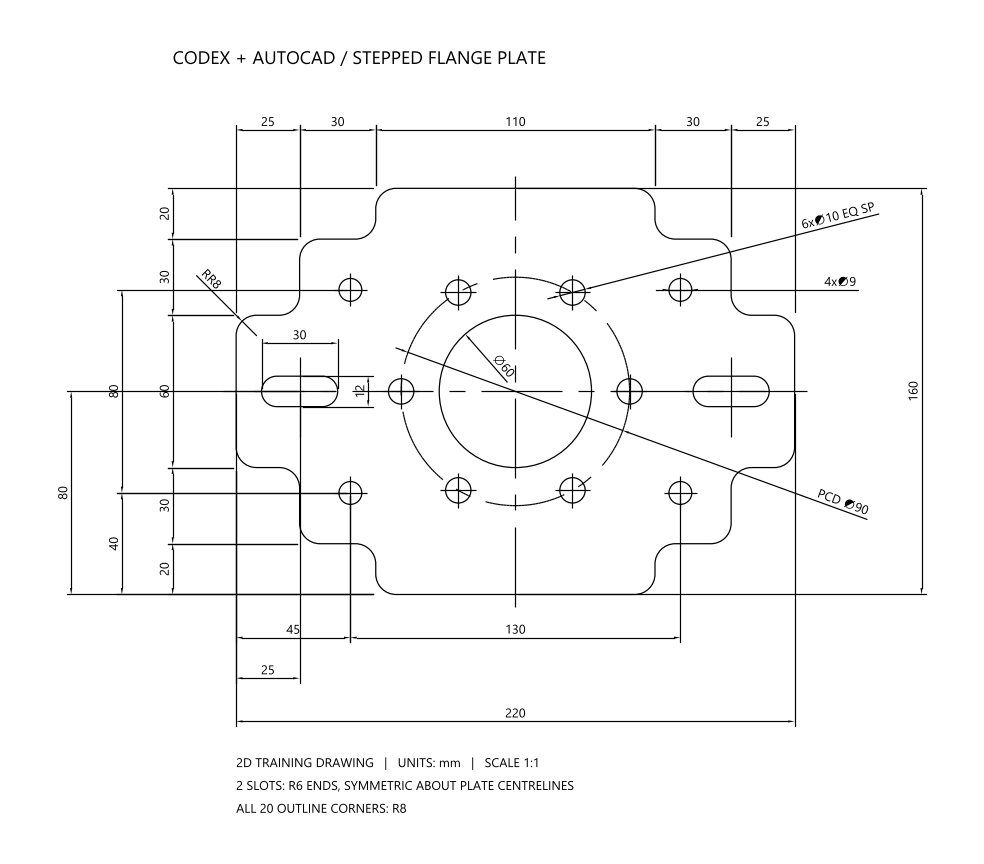

# 阶梯法兰安装板案例
单位毫米，模型1:1。打开 `flange_final.dwg` 查看参考图。
在新空白图纸中使用 APPLOAD 加载 `flange_demo.lsp`，依次运行 `CADOUTLINE`、`CADHOLES`、`CADDIMS`。

参数修改后请在新空白图纸中重新生成。现有图形不会随脚本参数自动更新。
此案例通过独立 AutoLISP 脚本生成，不通过圆角矩形底板 MCP 工具生成。

